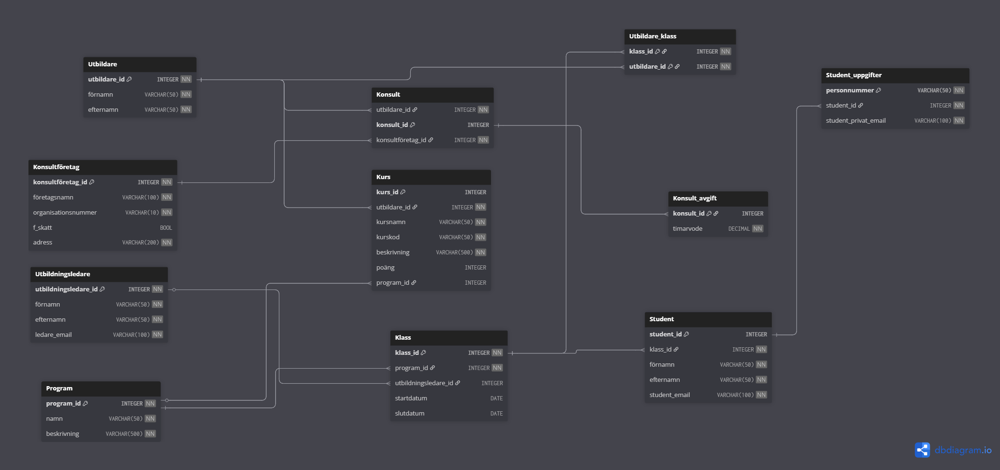

# YrkesCo Data Modeling


A relational database for YrkesCo, a fictional Swedish vocational school (yrkeshögskola), built as part of the Data Modeling course in the Data Engineering program at STI.

YrkesCo tracks students, educators, consultants, courses and programs in many separate Excel files. This project replaces them with one structured PostgreSQL database, designed step by step from business requirements to a working implementation.

## Modeling process

| Step | Result |
|---|---|
| 1. Conceptual model | [Entities and relationships](models/conceptual_model.png), described in [relationship statements](models/relationship_statements.md) (Swedish) |
| 2. Logical model | [Attributes, keys and cardinality](models/logical_model.png) |
| 3. Physical model | [PostgreSQL tables and data types](models/physical_model.png) |
| 4. Implementation | SQL scripts in [`sql/`](sql) |



The full walkthrough is in the [presentation](docs/yrkesco_presentation.pdf) (Swedish).

## Design decisions

- **Sensitive data in separate tables.** Personal identity numbers and private emails are stored in `Student_uppgifter`, and consultants' hourly rates in `Konsult_avgift`. This makes it easier to control who can access them.
- **Consultants are a type of educator.** All educators are stored in `Utbildare`, and `Konsult` adds consultant-specific information only for those who are consultants.
- **Many-to-many with a junction table.** An educator can teach several classes and a class can have several educators, which is handled by `Utbildare_klass`.
- **A class is one round of a program.** A program is granted in rounds, so one program can have several classes over time.
- **Third normal form (3NF).** Each non-key attribute depends only on its table's primary key. For example, company details are stored once in `Konsultföretag` instead of being repeated for every consultant.

## Example queries

[`sql/test_queries.sql`](sql/test_queries.sql) joins tables to answer questions like:

- Which education manager is responsible for a class?
- Which courses does a class have, and how many?
- Which educator teaches which course in a class?
- Which educators are consultants, and from which company?

## How to run

Requires Docker.

1. Create your `.env` file from the template and set your own password:
   ```bash
   cp .env.example .env
   ```

2. Start the PostgreSQL container:
   ```bash
   docker compose up -d
   ```

3. Open psql inside the container:
   ```bash
   docker exec -it yrkesco psql -U postgres -d yh_lab
   ```

4. Run the SQL scripts in order:
   ```
   \i /sql/yh_lab_fysisk_modell.sql
   \i /sql/fake_data.sql
   \i /sql/test_queries.sql
   ```

The `sql/` folder is mounted into the container as `/sql`, so the scripts can be run directly from psql.

Alternatively, `bash run_lab.sh` runs all three scripts in one go.

## Project structure

```
├── models/      # conceptual, logical and physical models + relationship statements
├── sql/         # table definitions, fake data and test queries
├── docs/        # presentation (PDF)
├── docker-compose.yml
├── run_lab.sh
└── .env.example
```

## Possible improvements

- Campuses (Gothenburg, Stockholm and future locations)
- Standalone courses that are not part of a program
- Courses shared between several programs